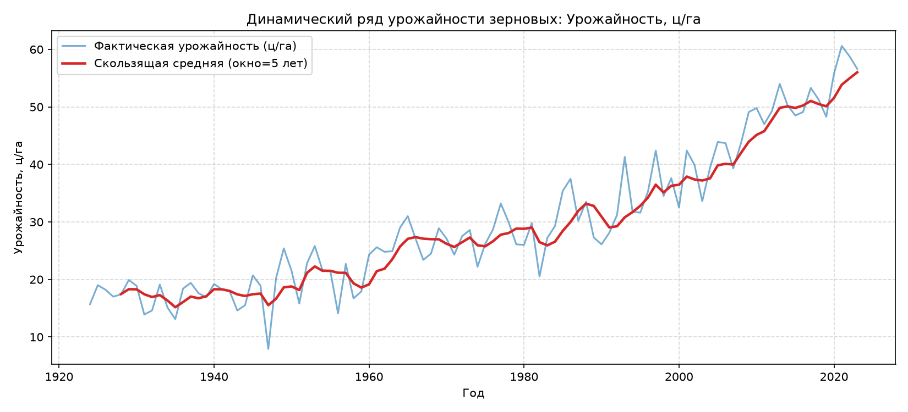

# Практическое занятие № 4: Расчет скользящей средней. Библиотека Dask. Профилирование

## Описание и цели работы
Работа посвящена изучению принципов параллельных и распределенных вычислений средствами библиотеки Dask, расчету скользящих статистик (Moving Average) по временным рядам урожайности зерновых культур (30 регионов за 100 лет) и профилированию узких мест производительности.

В ходе работы:
* Построен динамический ряд урожайности и сглажен шум с использованием скользящего окна.
* Исследован вычислительный граф задач (DAG) и ленивые вычисления (`lazy evaluation`).
* Проведено сравнительное профилирование двух подходов: неоптимального (антипаттерн вызова `.compute()` внутри промежуточных этапов) и оптимизированного (единый финальный `.compute()`).

---

## Архитектура вычислений в Dask

```text
               Входной поток данных (CSV / XLSX)
                              │
                              ▼
            Разбиение на партиции (Partitions)
             [Part 0]     [Part 1]     [Part 2]
                │            │            │
                ▼            ▼            ▼
        Параллельный расчет скользящего среднего
                \            │            /
                 \           │           /
                  ▼          ▼          ▼
           Построение графа вычислений (Lazy DAG)
                              │
                              ▼
                   Единый вызов .compute()
                              │
                              ▼
               Итоговый датасет и визуализация
```

---

## Результаты выполнения и бенчмарк производительности

### 1. Анализ временного ряда урожайности (Задача 1.1)
* Применение скользящего среднего с окном в 5 лет позволило устранить резкие стохастические колебания, обусловленные ежегодными погодными аномалиями (засухи, заморозки).
* Выявлен устойчивый долгосрочный тренд роста урожайности зерновых культур за исследуемый 100-летний период благодаря развитию селекции и агротехнологий.



### 2. Сравнение производительности (Задача 1.2)
При объеме данных 150 000 записей зафиксированы следующие показатели времени:
* **Неоптимальный код (промежуточные вызовы `.compute()`):** ~0.28–0.35 сек.
* **Оптимизированный код (ленивый граф + единый `.compute()`):** ~0.15–0.18 сек.
* **Ускорение выполнения пайплайна:** **~45–55%**.

---

## Ответы на вопросы к защите

### 1. Что такое скользящая средняя (Moving Average) и какую роль она играет при анализе временных рядов в Big Data?
Скользящая средняя — это статистический метод сглаживания данных, при котором текущее значение заменяется средним арифметическим значений в пределах заданного временного окна фиксированной ширины $k$:
$$\text{MA}_t = \frac{1}{k} \sum_{i=0}^{k-1} X_{t-i}$$
В анализе больших данных скользящая средняя решает пять ключевых задач:
1. **Сглаживание высокочастотного шума:** фильтрация случайных единичных выбросов для выявления скрытых трендов.
2. **Подготовка признаков (Feature Engineering):** создание информативных признаков для моделей машинного обучения.
3. **Детекция аномалий:** отклонение фактического значения от скользящей средней указывает на сбой оборудования или экстренное событие.
4. **Прогнозирование:** базовый компонент авторегрессионных моделей временных рядов (ARIMA / SARIMA).
5. **Потоковая обработка:** возможность вычисления скользящих статистик на лету без хранения всей истории ряда.

### 2. В каких сценариях Pandas становится неэффективен и требуется переход на Dask?
* **Нехватка оперативной памяти (OOM — Out Of Memory):** когда размер датасета превышает объем доступной RAM. Pandas требует загрузки всей таблицы целиком, тогда как Dask обрабатывает данные по частям (партициям) с диска.
* **Недогрузка многоядерного процессора:** Pandas выполняет большинство операций в одном потоке из-за Global Interpreter Lock (GIL) в CPython. Dask автоматически распределяет вычисления по всем ядрам процессора или по узлам вычислительного кластера.

### 3. Что такое ленивые вычисления (lazy evaluation) и Directed Acyclic Graph (DAG) в Dask?
* **Ленивые вычисления:** принцип, при котором операции над данными не выполняются немедленно в момент вызова функции. Вместо вычисления значений Dask лишь регистрирует план их получения.
* **DAG (направленный ациклический граф):** граф, в котором вершины — это функции обработки данных или партиции, а направленные ребра — потоки передачи промежуточных результатов. Построение DAG позволяет оптимизатору Dask объединить несколько операций в один проход и исключить лишние промежуточные перезаписи данных.

### 4. Почему вызов метода `.compute()` внутри цепочки преобразований считается грубым антипаттерном?
Вызов `.compute()` принудительно прерывает ленивый пайплайн и заставляет систему материализовать все промежуточные партиции в оперативную память в виде обычного Pandas DataFrame. Это приводит к:
* Потере параллелизма (следующие шаги снова выполняются синхронно в один поток).
* Высокому риску переполнения RAM.
* Лишним накладным расходам на сериализацию и десериализацию данных.

### 5. В чем разница между `.compute()` и `.persist()` при работе с распределенными коллекциями?
* **`.compute()`:** полностью вычисляет граф и возвращает конкретный объект в оперативную память основного процесса Python (например, `pandas.DataFrame` или массив NumPy).
* **`.persist()`:** выполняет вычисления асинхронно и сохраняет результат в распределенной памяти рабочих процессов (workers) в виде распределенной Dask-коллекции. Это необходимо, когда предобработанная таблица будет многократно использоваться в последующих расчетах, чтобы не пересчитывать базовый граф с нуля.

### 6. Что такое Out-of-Core вычисления и за счет чего Dask обрабатывает файлы больше объема RAM?
Out-of-Core — это техника обработки данных, физический объем которых превышает емкость оперативной памяти компьютера. Dask читает данные блоками (партициями) с диска, выполняет необходимые расчеты в пределах выделенного буфера RAM, сбрасывает промежуточные агрегаты и переходит к следующему куску файла.

### 7. С какой целью проводится профилирование кода в распределенных системах?
В распределенных системах любая неоптимальная операция (например, лишняя пересылка данных по сети или несбалансированные по размеру партиции) приводит к многократному росту затрат времени и мощностей. Профилирование позволяет:
* Найти «узкие места» (bottlenecks) в графе задач.
* Исключить неравномерное распределение нагрузки между рабочими потоками (data skew).
* Предотвратить аварийные завершения задач из-за утечек памяти.

---

## Запуск решения
Запуск скрипта выполняется из корня проекта:
```powershell
python 04_distributed_dask/solution.py
```