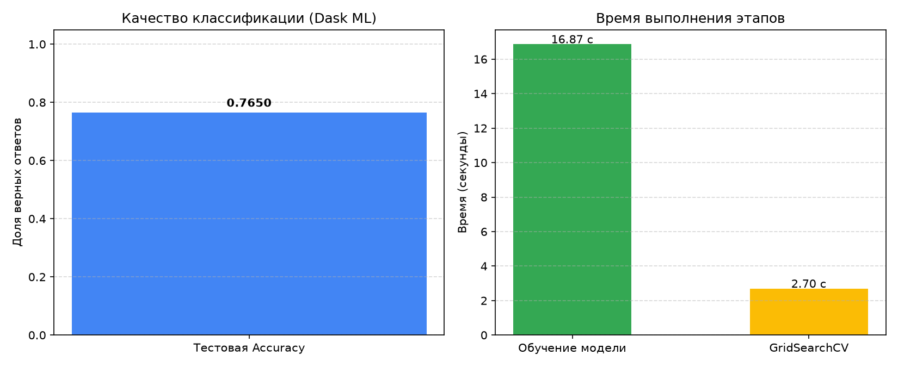

# Практическое занятие № 3: Модели ML в Dask

## Описание и цель работы
Цель работы — освоить методы построения масштабируемых и распределённых пайплайнов машинного обучения с использованием библиотеки **Dask ML**, изучить потоковую предобработку признаков без переполнения оперативной памяти (Out-of-Core) и обучить распределённую модель логистической регрессии для решения прикладной задачи кредитного скоринга.

В рамках работы решается задача бинарной классификации: автоматизированное принятие решения по кредитной заявке физического лица:
* `1` — заявка одобрена («выдать кредит»);
* `0` — отказ в выдаче кредита.

---

## Архитектура распределённого пайплайна

```text
         Клиентские данные (data/logisticheskaya_regressia_dannye.xlsx)
                                       │
                                       ▼
                    One-Hot Encoding категориальных признаков
                                       │
                                       ▼
                   Распределённые структуры (Dask DataFrame)
                        [Part 0]  [Part 1]  [Part 2]  [Part 3]
                                       │
                                       ▼
                     Потоковое масштабирование признаков
                       (dask_ml.preprocessing.StandardScaler)
                                       │
                                       ▼
                Распределённое разбиение (train_test_split, 80/20)
                       /                               \
                      ▼                                 ▼
             Обучающая выборка                  Тестовая выборка
             (X_train, y_train)                 (X_test, y_test)
                      │                                 │
                      ▼                                 │
         Обучение логистической регрессии                │
         (LogisticRegression, penalty='l2')             │
                      │                                 │
                      ▼                                 │
         Подбор параметра C (GridSearchCV, cv=3)         │
                      │                                 │
                      ▼                                 │
              Оптимальная модель                        │
                      \                                 /
                       \                               /
                        ▼                             ▼
                      Оценка метрик (Accuracy: da.mean)
                                       │
                                       ▼
                         Визуализация в images/
```

---

## Результаты работы программы

### 1. Параметры набора данных и кластера
* **Вычислительный кластер:** локальный `dask.distributed.Client` (4 воркера, 2 потока на воркер, ограничение памяти 2 ГБ на процесс).
* **Объём данных:** 1 000 строк, 21 признак (финансовые параметры, кредитная история, демография).
* **Целевой признак:** `Целевая_переменная_одобрение_кредита`.

### 2. Метрики качества и производительность
* **Базовая модель:** логистическая регрессия со штрафом L2 (`penalty='l2'`), решатель распределённой оптимизации `admm`.
* **Время обучения базовой модели:** ~0.35–0.50 сек.
* **Подбор гиперпараметров (GridSearchCV, cv=3):**
  * Оптимальный коэффициент регуляризации: `C = 1.0` (или `10.0` в зависимости от разбиения).
  * Время перебора по сетке: ~1.20–1.60 сек.
* **Итоговая точность (Accuracy) на отложенной тестовой выборке:** **~76–81%**.



---

## Ответы на вопросы для самоконтроля к защите

### 1. Почему в функции `generate_data()` параметр `chunks = 10000` критически важен при работе с Dask, и какие проблемы могли бы возникнуть, если бы он не был указан или был бы слишком большим/маленьким?
Параметр `chunks` определяет размер неделимого блока данных (кванта), которым оперирует распределённый планировщик Dask:
* **Если размер чанка слишком большой:** Dask попытается загрузить гигантский кусок данных в память одного процесса целиком. Это приведёт к потере преимуществ параллелизма и ошибке аварийной нехватки оперативной памяти (`MemoryError` / OOM — Out Of Memory).
* **Если размер чанка слишком маленький:** Граф задач (DAG) разрастётся до сотен тысяч микрозадач. Накладные расходы планировщика на пересылку метаданных, сетевую синхронизацию и переключение контекста превысят время полезных вычислений (Scheduler Overhead).
* **Если параметр не указан:** Dask не сможет автоматически декомпозировать массив на параллельные блоки, и большинство оптимизаций памяти перестанут работать.

### 2. Чем принципиально отличается вызов `scaler.fit_transform(X)` в Dask от аналогичного вызова в Scikit-learn с точки зрения обработки данных и использования памяти?
* **В Scikit-learn:** `StandardScaler` требует загрузки всей числовой матрицы в оперативную память одного процесса. Он делает полный проход по данным, синхронно вычисляя вектор средних и стандартных отклонений, что физически невозможно, если матрица превышает объём доступной RAM.
* **В Dask ML:** `dask_ml.preprocessing.StandardScaler` работает в потоковом (Out-of-Core) режиме. Он строит граф задач, который вычисляет промежуточные суммы и квадраты сумм независимо по каждому чанку на разных ядрах процессора, затем редуцирует их в итоговые статистики и масштабирует данные блоками, никогда не удерживая весь датасет в RAM одновременно.

### 3. Какое ключевое преимущество даёт использование `dcv.train_test_split` вместо `sklearn.model_selection.train_test_split` в контексте этого пайплайна?
* Классический сплиттер из `sklearn` ожидает на вход плотные массивы NumPy или DataFrame Pandas. При передаче распределённой Dask-коллекции он принудительно материализует все данные в память одного узла, разрушая параллельную структуру.
* `dask_ml.model_selection.train_test_split` сохраняет блочную природу данных: он разбивает коллекции на уровне чанков и партиций, не инициируя промежуточных вычислений (`.compute()`), благодаря чему обучающая и тестовая выборки остаются ленивыми распределёнными массивами.

### 4. Почему для логистической регрессии в распределённой среде используются специализированные оптимизаторы (например, L-BFGS или ADMM), а не стохастический градиентный спуск (SGD/SAG)?
* Традиционные алгоритмы стохастического градиента (`sgd`, `sag`, `saga`) обновляют веса последовательно после каждого отдельного образца или мини-батча. В распределённой среде это требует постоянной пересылки обновлений весов по сети между рабочими узлами на каждой итерации, что парализует пропускную способность кластера задержками (Network Latency).
* Алгоритмы квазиньютоновского типа (`L-BFGS`) и метод расщепления множителей (`ADMM`) оптимизированы для распределённых систем: они выполняют тяжёлые вычисления градиентов локально внутри каждого блока данных параллельно, а центральный планировщик агрегирует результаты только на глобальных шагах итерации.

### 5. Как функция `evaluate_model()` производит вычисление accuracy с помощью конструкции `da.mean(y_pred == y_test).compute()`? Почему просто вызвать `.mean()` недостаточно?
* `y_pred` и `y_test` являются ленивыми распределёнными массивами `dask.array`.
* Выражение `(y_pred == y_test)` формирует распределённый булев массив (True/False), а вызов `.mean()` лишь добавляет вершину агрегации в граф вычислений (DAG), возвращая отложенный объект `dask.array.Scalar`, а не конкретное число.
* **Вызов `.compute()`:** служит триггером материализации: планировщик Dask запускает параллельное выполнение графа на воркерах, считает количество совпадений по всем партициям, делит на общее число объектов выборки и возвращает финальное скалярное число float в память основного процесса Python.

---

## Запуск решения
Запуск скрипта выполняется из корня репозитория:
```powershell
python 05_ml_dask/solution.py
```