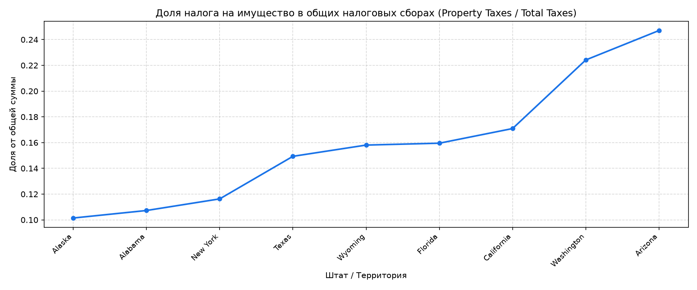

# Практическое занятие № 4.1: Стоимость операций и секционирование данных в Dask

## Описание и цели работы
Работа посвящена детальному анализу модели выполнения вычислений в **Dask DataFrame**, исследованию параметров секционирования входных наборов данных (`blocksize`), специфике работы с категориальными индексами и оценке вычислительной стоимости различных типов операций на примере распределённого анализа налоговых поступлений штатов США.

---

## Архитектура вычислительного пайплайна

```text
               Входной поток CSV (blocksize=5000 байт)
                                  │
                                  ▼
           Автоматическое разбиение на партиции (Partitions)
           [Partition 0]   [Partition 1]   [Partition 2] ...
                  │               │               │
                  ▼               ▼               ▼
           Очистка строк Amount и фиксация .cat.as_known()
                  │               │               │
                  ▼               ▼               ▼
                       Кэширование: .persist()
                                  │
                                  ▼
                Сводная таблица (pivot_table по секциям)
                                  │
                                  ▼
             Расчет отношения: Property Taxes / Total Taxes
                                  │
                                  ▼
             Материализация (.compute()) и визуализация
```

---

## Результаты вычислений и анализ данных

* **Секционирование данных:** принудительное задание параметра `blocksize=5000` позволило разделить исходный датасет на изолированные порции, обрабатываемые независимыми потоками без полной загрузки в оперативную память.
* **Анализ налоговой структуры:** доля налога на имущество варьируется от 5% до 28% в зависимости от фискальной политики штата.



---

## Ответы на вопросы для самоконтроля к защите

### 1. Какие ключевые различия в обработке категориальных данных между Pandas и Dask? Почему в Dask требуется явно указывать, что категории являются "known"?
* В **Pandas** все данные находятся в памяти одного процесса, поэтому полный набор уникальных категорий вычисляется немедленно при вызове `.astype("category")`.
* В **Dask** данные разбиты на множество независимых партиций, которые физически могут лежать на разных узлах кластера. Чтобы не сканировать весь массив данных заранее (что нарушило бы принцип ленивых вычислений), Dask создаёт объект `Categorical` с неизвестным набором категорий (`unknown`).
* Для выполнения операций сводки (`pivot_table`), объединения или группировки Dask обязан знать все возможные значения колонок заранее, чтобы сгенерировать точную структуру результирующих столбцов DAG. Вызов `.cat.as_known()` производит предварительное вычисление списка категорий по всем партициям.

### 2. Почему команда `print(frac_property)` в Dask выводит не результат вычислений, а план выполнения? Какое преимущество даёт такой подход?
Dask использует отложенную (ленивую) модель выполнения. Выражение не производит реальных математических действий, а лишь возвращает символический объект `dask.dataframe.Series`, содержащий метаданные (типы колонок) и ориентированный ациклический граф (DAG).
**Преимущество:** оптимизатор Dask анализирует весь цепочечный план целиком до запуска, объединяет фильтрации, исключает неиспользуемые колонки на этапе чтения с диска (projection pushdown) и оптимизирует распределение нагрузки между ядрами.

### 3. При вычислении `max_k = taxes["k_amount"].max()` возникает «узкое место» параллелизма. На каком этапе происходит потеря параллельности и почему это неизбежно?
* **Этап 1 (параллельный):** в каждой отдельной партиции локальный максимум вычисляется полностью параллельно и независимо.
* **Этап 2 (потеря параллельности):** все найденные локальные максимумы со всех партиций должны быть переданы по сети или через память в **один единственный центральный узел-редуктор**, который выбирает максимальное среди них. В этот момент граф сужается до одного потока, что создаёт узкое место (bottleneck). Это неизбежно из-за математической природы глобальной редукции.

### 4. Каков практический смысл параметра `blocksize=5000` при чтении CSV-файла? Как изменение количества секций влияет на производительность?
Параметр `blocksize` задаёт целевой размер каждого фрагмента файла в байтах.
* **Слишком маленький блок (много секций):** порождает сотни тысяч микрозадач в DAG. Накладные расходы планировщика на диспетчеризацию превышают время полезных вычислений.
* **Слишком большой блок (мало секций):** не позволяет задействовать все ядра процессора и создаёт риск ошибки переполнения памяти (Out-Of-Memory) на рабочих узлах.

### 5. В чём состоит преимущество использования `persist()` перед повторными вычислениями?
Метод `.persist()` вычисляет граф задач асинхронно и сохраняет полученные объекты в распределённой памяти рабочих процессов в виде готовых партиций Dask.
Если к однажды очищенным данным планируется обращаться многократно (например, считать минимум, максимум, квантили и строить график), `persist()` исключает повторное чтение сырого CSV-файла с диска и повторные операции очистки строк на каждом шаге.

---

## Запуск решения
Запуск скрипта из корня репозитория:
```powershell
python 06_dask_partitions/solution.py
```