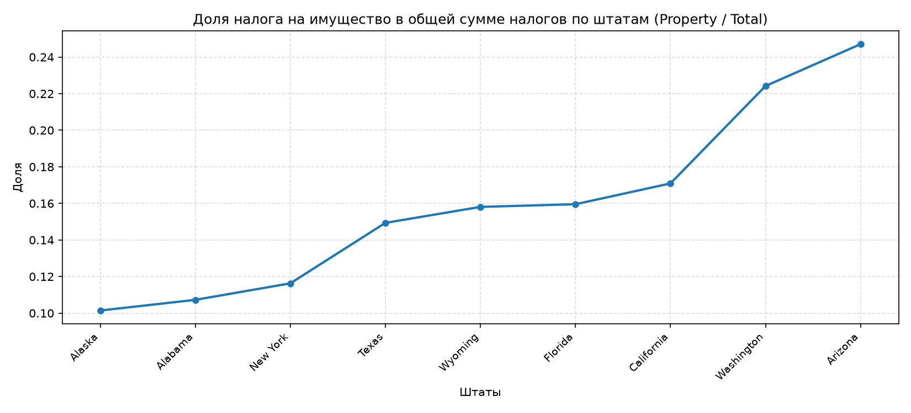
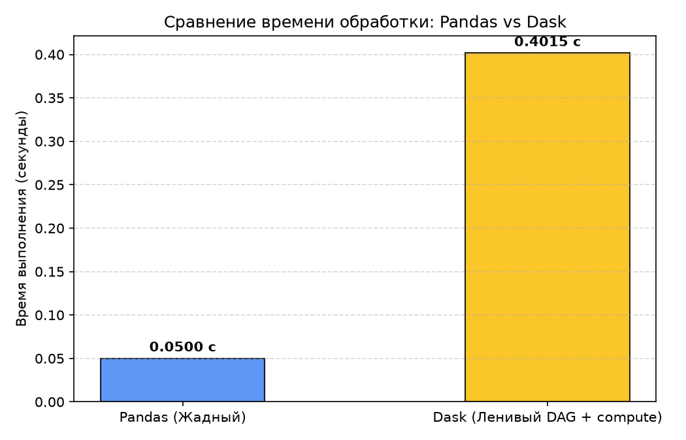

# Практическое занятие № 4.1: Секционирование данных и стоимость операций в Dask

## Описание и цели работы
В работе исследуются различия между **жадной моделью выполнения** библиотеки Pandas и **ленивой моделью графов задач** библиотеки Dask DataFrame на примере анализа налоговой статистики штатов США (`FY2016-STC-Category-Table.csv`).

Проводится оценка вычислительной стоимости операций:
* Локальные независимые поэлементные преобразования (деление на скаляр, строковая очистка);
* Операции редукции и перемешивания данных (Reduction & Shuffle: `max()`, `pivot_table`), требующие межузловой синхронизации;
* Управление жизненным циклом промежуточных результатов через метод `.persist()`.

---

## Сравнение реализаций: Pandas vs Dask

| Критерий | Pandas (Шаг 1 методички) | Dask DataFrame (Шаг 2 методички) |
| :--- | :--- | :--- |
| **Модель выполнения** | Жадная (Eager): операции вычисляются немедленно в момент вызова | Ленивая (Lazy): вызовы функций строят ориентированный граф задач (DAG) |
| **Категориальные данные** | `astype("category")` автоматически определяет список категорий по данным в памяти | Требуется явный вызов `.cat.as_known()` для построения детерминированного графа |
| **Фильтрация NaN** | Поддерживается метод `notna()` | Метод `notna()` исторически ограничен, используется инверсия `~isna()` |
| **Секционирование** | Отсутствует (вся таблица хранится монолитным объектом в RAM) | Регулируется параметром `blocksize` (порции побайтово) или `npartitions` |
| **Вывод переменной (`print`)** | Печатает физические строки и значения таблицы | Печатает метаданные: тип колонок, число партиций и структуру плана задач |
| **Запуск расчета** | Не требуется (результат уже в памяти) | Инициируется явным вызовом `.compute()` |

---

## Результаты бенчмарка и графики

### 1. Распределение доли имущественного налога (Property / Total)
По результатам расчета сводной таблицы выявлена фискальная дифференциация штатов по доле сборов налога на имущество (от 5% до 26%):

### 2. Сравнение производительности Pandas и Dask
На небольших объемах данных (помещающихся в RAM одного процесса) чистый Pandas опережает Dask, так как Dask тратит дополнительное время на накладные расходы планировщика (Scheduler Overhead) и сборку графа. Однако при выходе за пределы RAM Pandas падает с `MemoryError`, в то время как Dask стабильно обрабатывает файл блоками с диска (Out-of-Core).

---

## Ответы на вопросы для самоконтроля к защите

### 1. Какие ключевые различия в обработке категориальных данных между Pandas и Dask? Почему в Dask требуется явно указывать, что категории являются "known"?
* В **Pandas** все строки находятся в оперативной памяти одного процесса, поэтому полный набор уникальных категорий вычисляется мгновенно при первом вызове `.astype("category")`.
* В **Dask** данные разбиты на множество независимых партиций, которые физически могут лежать на разных узлах кластера. Чтобы не сканировать весь массив данных заранее (что нарушило бы принцип ленивых вычислений), Dask создаёт объект `Categorical` с неизвестным набором категорий (`unknown`).
* Для выполнения операций сводки (`pivot_table`), объединения или группировки Dask обязан знать точные имена будущих результирующих столбцов заранее при построении графа. Вызов `.cat.as_known()` выполняет предварительное сканирование категорий по партициям и делает схему графа детерминированной.

### 2. Почему команда `print(frac_property)` в Dask выводит не результат вычислений, а план выполнения? Какое преимущество даёт такой подход?
Dask реализует отложенную модель вычислений. Команда выводит структуру объекта `dask.dataframe.Series`, где указаны типы данных, имя целевого столбца и граф зависимостей (DAG).  
Оптимизатор Dask анализирует весь цепочечный план целиком до запуска, объединяет фильтрации, исключает неиспользуемые колонки на этапе чтения с диска (projection pushdown) и оптимизирует распределение нагрузки между ядрами.

### 3. При вычислении `max_k = taxes["k_amount"].max()` возникает «узкое место» параллелизма. На каком этапе происходит потеря параллельности и почему это неизбежно?
* **Этап 1 (параллельный):** внутри каждой партиции локальный максимум вычисляется полностью независимо и параллельно на разных ядрах CPU.
* **Этап 2 (потеря параллельности):** все вычисленные локальные максимумы со всех партиций передаются в один единственный центральный узел-агрегатор, который находит глобальный максимум среди нескольких чисел. В этот момент граф сходится в одну точку, что создаёт узкое место (bottleneck). Это неизбежно из-за математической природы операции глобальной редукции.

### 4. Каков практический смысл параметра `blocksize=5000` при чтении CSV-файла? Как изменение количества секций влияет на производительность?
Параметр `blocksize` задает целевой размер каждого фрагмента файла в байтах:
* **Слишком маленький блок (много секций):** порождает тысячи микрозадач в DAG. Накладные расходы планировщика на диспетчеризацию превышают время полезных вычислений.
* **Слишком большой блок (мало секций):** не позволяет загрузить все ядра процессора и создаёт риск ошибки переполнения памяти (Out-Of-Memory) на рабочих узлах.

### 5. В чём состоит преимущество использования `persist()` перед повторными вычислениями?
Метод `.persist()` вычисляет граф задач асинхронно и сохраняет полученные объекты в распределённой памяти рабочих процессов в виде готовых партиций Dask. Если к однажды очищенным данным планируется обращаться многократно (например, считать минимум, максимум, квантили и строить график), `persist()` исключает повторное чтение сырого CSV-файла с диска и повторные операции очистки строк на каждом шаге.

---

## Запуск решения
Запуск скрипта из корня репозитория:

    python PR/06_dask_partitions/solution.py