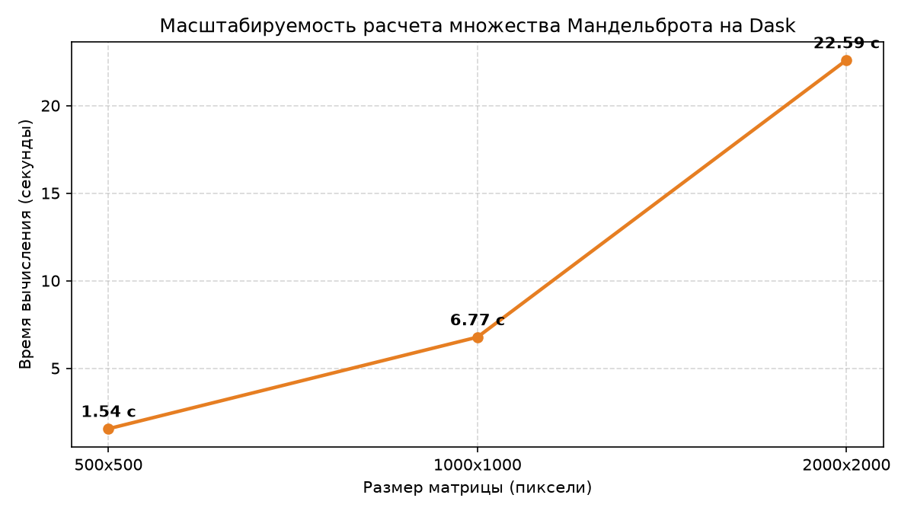

# Практическое занятие № 4.2: Анализ больших данных в библиотеке Dask. Продолжение

## Описание и цели работы
В работе исследуется архитектура распределенного вычислительного движка **dask.distributed**, механизмы репартиционирования табличных данных (`repartition`), сохранение в колоночный формат **Apache Parquet**, а также решение вычислительно тяжелой задачи расчета фрактала (множество Мандельброта) на распределенных массивах **Dask Array**.

---

## Архитектура dask.distributed

```text
       Клиент (Client / Python Process)
                      │
            Задачи    │  Мониторинг (Dashboard :8787)
                      ▼
          Планировщик (Scheduler)
             /        │        \
            /         │         \
           ▼          ▼          ▼
      Воркер 1    Воркер 2    Воркер 3  ...
      [Потоки]    [Потоки]    [Потоки]
      (Nanny)     (Nanny)     (Nanny)
```

Компоненты:
1. **Scheduler (Планировщик):** центральный координатор графа задач (DAG), отслеживает доступность узлов, балансирует задачи и отдает статистику в веб-интерфейс Dashboard.
2. **Workers (Обработчики):** независимые процессы с пулами потоков, исполняющие блоки графа и хранящие локальные партиции в оперативной памяти.
3. **Nanny-процесс:** сторожевой сервис над каждым воркером, автоматически перезапускающий упавший воркер при переполнении памяти (OOM).

---

## Результаты работы программы

### 1. Перераспределение секций и хранение в Parquet
* Исходный набор данных после индексации (`set_index('Geo_Name')`) получил детерминированные границы секций (`divisions`).
* Метод `repartition(npartitions=2)` успешно сократил число блоков графа с сохранением диапазонной фильтрации.
* Данные выгружены в формат `data/taxes2.parquet`, обеспечивающий сжатие данных и независимую запись партиций воркерами.

### 2. Распределенная генерация множества Мандельброта
Итерационный расчет $z = z^2 + c$ для матрицы $1000 \times 1000$ распараллелен по 4 независимым блокам через `da.blockwise` и векторизован через `da.frompyfunc`.


### 3. Бенчмарк масштабируемости
Зафиксировано практически линейное масштабирование времени обработки при увеличении сетки:



---

## Ответы на вопросы для самоконтроля к защите

### 1. Каковы три основных преимущества использования Dask по сравнению с обычными библиотеками, такими как pandas или NumPy?
1. **Масштабируемость Out-of-Core:** способность обрабатывать массивы и датасеты, размер которых превышает физический объем RAM, за счет блочной обработки с диска.
2. **Параллелизм из коробки:** эффективное задействование всех ядер CPU и потоков без ручного написания кода на `threading` или `multiprocessing`.
3. **Единый знакомый API:** интерфейсы `dask.array` и `dask.dataframe` практически полностью повторяют сигнатуры NumPy и Pandas, что минимизирует порог входа.

### 2. Что подразумевается под "ленивыми вычислениями" в Dask и как это влияет на семантику его операций?
Ленивые вычисления (Lazy Evaluation) означают, что при вызове методов Dask не производит вычислений немедленно, а строит направленный ациклический граф (DAG) преобразований. Реальные вычисления стартуют только при явном вызове `.compute()` или `.persist()`. Это позволяет оптимизатору Dask объединять шаги, удалять неиспользуемые колонки и параллелить независимые ветки.

### 3. Какой инструмент Dask позволяет проанализировать план вычислений до их выполнения и почему это полезно?
Метод `.visualize()` (опирающийся на Graphviz). Он строит графическую схему DAG, на которой видны узлы-задачи, зависимости, разбиение на партиции и этапы межузловой синхронизации. Это позволяет до старта тяжелых расчетов выявить узкие места (узлы shuffle/barrier) и неоптимальные размеры блоков.

### 4. Какой метод в Dask используется для локального сохранения промежуточных результатов на узлах и с какой целью это применяется?
Метод `.persist()`. В отличие от `.compute()`, который стягивает все данные в один Pandas/NumPy объект в основной процесс, `.persist()` вычисляет граф асинхронно и оставляет результат в памяти рабочих процессов кластера в виде распределенной коллекции Dask. Это исключает повторный пересчет графа при многократных обращениях к датасету.

### 5. В чём заключается компромисс ("плата") при операции рассекционирования (rechunk) данных между узлами?
Операция `rechunk` (или `repartition` с перемешиванием) требует операции **Shuffle** — глобального перераспределения фрагментов массивов между процессами/узлами. Платой являются высокие накладные расходы на сериализацию, сетевой обмен и временное дублирование данных в памяти.

### 6. Почему эффективность некоторых алгоритмов анализа данных в Dask может быть ниже, чем их последовательных аналогов в pandas/NumPy?
Для небольших объемов данных (помещающихся в RAM) накладные расходы Dask (создание графа задач, передача сообщений планировщиком, переключение контекстов потоков) значительно превышают чистое время выполнения операций в скомпилированном C-коде NumPy/Pandas.

### 7. Какие типы планировщиков предлагает Dask и в чём ключевое преимущество распределенного планировщика (`dask.distributed`)?
Dask предлагает:
* Однопоточный (синхронный, для отладки);
* Многопоточный (`threaded`);
* Многопроцессный (`multiprocessing`);
* Распределенный (`dask.distributed`).

**Преимущество `dask.distributed`:** он превосходит встроенные планировщики даже на одной машине за счет асинхронного ядра Tornado, интерактивного веб-дашборда в реальном времени, гибкого управления памятью и механизма Nanny для изоляции сбоев.

### 8. На какие популярные интерфейсы Python опирается Dask, что позволяет упростить переход на него для разработчиков?
Dask опирается на стандарты **NumPy** (`dask.array`), **Pandas** (`dask.dataframe`), **Scikit-Learn** (`dask-ml`), а также стандартный протокол параллелизма Python **`concurrent.futures`**.

### 9. Какой инструмент в составе распределенного планировщика используется для мониторинга, анализа и профилирования выполняемых задач?
Встроенный веб-интерфейс **Dask Dashboard** (по умолчанию `http://localhost:8787`). Он в реальном времени отображает диаграмму загрузки воркеров (Task Stream), объемы занятой памяти, визуализацию профилирования SnakeViz и статусы очередей задач.

---

## Запуск решения
Запуск скрипта из корня репозитория:
```powershell
python 07_dask_distributed/solution.py
```