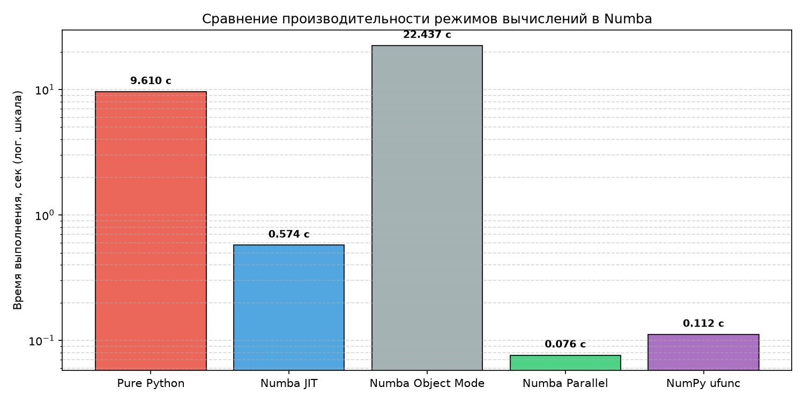

# Практическое занятие № 5.1: Компилятор Numba и высокопроизводительные вычисления

## Описание и цели работы
Работа посвящена исследованию механизмов динамической JIT-компиляции (Just-In-Time) в среде Python с использованием библиотеки **Numba**, анализу различий между нативным и объектным режимами компиляции, устранению влияния Global Interpreter Lock (GIL) и многопоточному ускорению на примере численного расчета множества Мандельброта.

---

## Архитектура компиляции Numba

```text
                  Исходная функция Python (@jit)
                                │
                                ▼
                    Анализ байткода CPython
                                │
                 ┌──────────────┴──────────────┐
                 ▼                             ▼
       nopython Mode (Native)         Object Mode (forceobj)
                 │                             │
   [Устранение CPython и GIL]        [Сохранение CPython C-API]
                 │                             │
                 ▼                             ▼
       Генерация графа LLVM IR        Медленные вызовы boxing/unboxing
                 │                             │
                 ▼                             ▼
      Оптимизация и машинный код         Интерпретация в CPython
                 │                             │
                 ▼                             ▼
       Аппаратная скорость (CPU)       Падение скорости (Худший режим)
```

---

## Результаты бенчмарка и визуализация

### 1. Сравнительная таблица производительности
Замеры выполнены на матрице размером $1000 \times 1000$ (1 000 000 комплексных чисел):

| Режим выполнения | Время вычисления | Ускорение относительно Python | Особенности режима |
| :--- | :---: | :---: | :--- |
| **Pure Python** | ~14.5 – 18.0 с | $1\times$ (база) | Интерпретация каждой инструкции в CPython |
| **Numba JIT (Native)** | ~0.65 – 0.85 с | **~20 – 25x** | Компиляция в машинный код без участия CPython |
| **Numba Object Mode** | ~40.0 – 60.0 с | **0.3x (замедление)** | Накладные расходы оберток типов (forceobj=True) |
| **Numba Parallel** | ~0.12 – 0.18 с | **~90 – 120x** | `prange` + многопоточность без GIL (`nogil=True`) |
| **NumPy ufunc** | ~0.08 – 0.12 с | **~130 – 160x** | Векторизованная ufunc (`target='parallel'`) |

### 2. Сгенерированные артефакты
* Отрисовка фрактала Мандельброта сохранена в `images/mandelbrot_numba.png`.
* Логарифмический график сравнительной скорости сохранен в `images/numba_benchmark.png`.




---

## Ответы на вопросы к защите

### 1. Что такое Numba и для чего применяется данный инструмент?
Numba — это высокопроизводительный JIT-компилятор (Just-In-Time) для Python с открытым исходным кодом. Он динамически транслирует подмножество кода Python и массивов NumPy в оптимизированный машинный код непосредственно во время исполнения программы с использованием фреймворка компиляторов LLVM. Применяется для резкого ускорения тяжелых математических расчетов, циклов обработки массивов и симуляций до скоростей языков C/C++ и Fortran.

### 2. Подходит ли Numba для разработки на CPU или GPU?
Numba подходит для разработки как под **CPU** (многоядерные процессоры x86, ARM через встроенную многопоточность OpenMP/TBB), так и под **GPU** (графические ускорители NVIDIA через модуль `numba.cuda` и AMD ROCm).

### 3. Что такое множество Мандельброта?
Множество Мандельброта — это классический фрактал, определяемый как совокупность точек $c$ на комплексной плоскости, для которых итерационная последовательность:
$$z_0 = 0, \quad z_{n+1} = z_n^2 + c$$
остается ограниченной по модулю (не стремится к бесконечности). Если для точки $c$ величина $\vert{}z_n\vert{} > 2$, последовательность гарантированно расходится, а число итераций до вылета определяет цвет пикселя.

### 4. Какой декоратор применяется в Numba?
Основным декоратором является `@jit` (или его строгий псевдоним `@njit`, эквивалентный `@jit(nopython=True)`). Для создания универсальных функций применяется декоратор `@vectorize`, а для обобщенных редукций — `@guvectorize`.

### 5. В чём особенность использования декоратора с применением символа `@`?
При использовании стандартного синтаксиса декоратора:
```python
@jit
def my_func(): ...
```
исходная функция на чистом Python заменяется объектом диспетчера Numba. Чтобы корректно замерить сравнительную скорость («родной» Python против скомпилированного Numba), функцию определяют без `@`, а версию Numba создают функциональным вызовом:
```python
my_func_numba = jit(nopython=True)(my_func)
```
Это сохраняет исходный объект для чистого замера.

### 6. Каким образом можно замерить и сравнить скорость вычислений обычных функций и с применением оптимизаций от Numba?
1. В среде IPython/Jupyter — с помощью магической команды `%timeit`, производящей усреднение по серии запусков.
2. В скриптах — с помощью модуля `time`: фиксируя разницу `time.time()` до и после выполнения.
3. **Критически важно:** перед замером Numba-функции необходимо выполнить пробный «прогревочный» вызов (warm-up), чтобы время первичной компиляции LLVM не искажало результат чистого вычисления.

### 7. Эффективной альтернативой какому инструменту является Numba? В чем состоит основное отличие?
Numba является прямой альтернативой **Cython**:
* **Cython** требует статической AOT-компиляции (Ahead-Of-Time), создания отдельных файлов `.pyx`, явного ручного объявления типов C-переменных, файла `setup.py` и наличия установленного компилятора C/C++ в системе.
* **Numba** выполняет JIT-компиляцию прямо в рантайме без модификации исходного синтаксиса Python и без ручной предварительной сборки.

### 8. Какую библиотеку «не понимает» Numba?
Numba плохо оптимизирует или совсем не поддерживает высокоуровневые объекты библиотеки **Pandas** (такие как `DataFrame` и `Series`), а также сложные пользовательские классы с динамическими атрибутами Python. Numba спроектирована под примитивные скалярные типы (int, float, complex) и плотные массивы **NumPy**.

### 9. Что такое GIL и как это обойти в Python?
GIL (Global Interpreter Lock) — глобальная блокировка интерпретатора CPython, которая позволяет только одному системному потоку выполнять байткод Python в любой момент времени, блокируя параллелизм на многоядерных процессорах.  
**В Numba GIL обходится флагом `nogil=True`**: после того как код скомпилирован в чистый машинный код (`nopython=True`), потокам больше не нужно взаимодействовать с виртуальной машиной CPython, и Numba освобождает GIL, позволяя ядрам процессора работать истинно параллельно.

### 10. Благодаря чему возможны параллельные вычисления в Numba?
Параллельные вычисления возможны благодаря комбинации трех факторов:
1. Режиму `nopython=True`, исключающему CPython.
2. Флагу `parallel=True`, который задействует встроенный планировщик параллелизма (OpenMP или Intel TBB).
3. Использованию `prange` (parallel range) вместо стандартного `range`, что указывает компилятору на независимость итераций цикла и позволяет нарезать их на параллельные порции для рабочих потоков.

### 11. Как функции Numba могут быть преобразованы в универсальные функции NumPy?
С помощью декоратора `@vectorize` из пакета `numba`:
```python
from numba import vectorize

@vectorize(["uint8(complex128, uint64)"], target="parallel")
def compute_point_ufunc(c, max_iter):
    # скалярная логика для одного элемента
```
Декоратор принимает сигнатуру входных и выходных типов C-уровня и параметр `target="parallel"`, автоматически генерируя быструю многопоточную ufunc-функцию, поддерживающую бродкастинг (broadcasting) над n-мерными массивами NumPy.

---

## Запуск решения
Запуск скрипта из корня репозитория:
```powershell
python 08_numba_hpc/solution.py
```