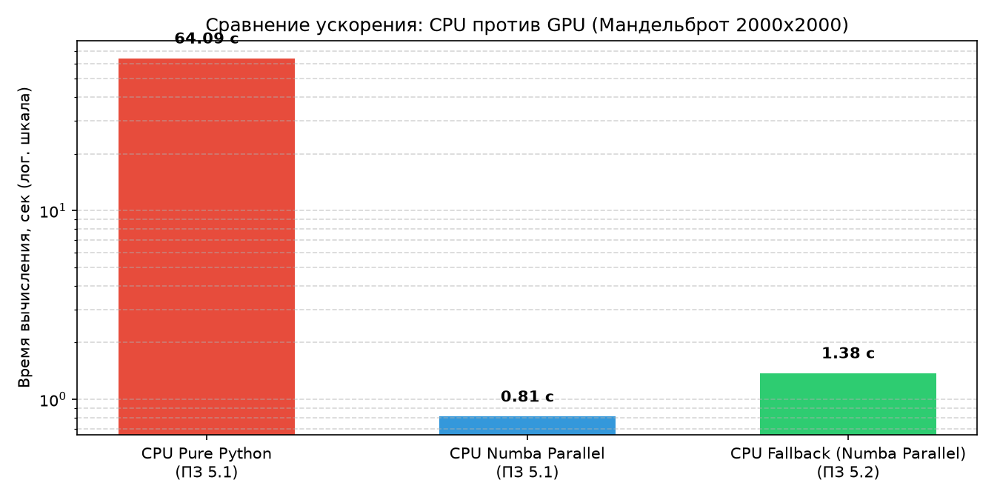

# Практическое занятие № 5.2: Использование компилятора Numba для генерации кода под GPU

## Описание и цель работы
Работа посвящена изучению архитектуры параллельных вычислений на графических процессорах (NVIDIA CUDA) с использованием компилятора **Numba**. Исследуется концепция запуска вычислительных ядер (Kernels), иерархия сетки потоков (Grids, Blocks, Threads), безопасная адресация элементов без выхода за границы массивов, а также реализация двумерного генератора множества Мандельброта с аппаратным ускорением на GPU.

---

## Архитектура вычислений CUDA в Numba

```text
               Хост (CPU / Python Runtime)
                            │
              Параметры     │ [blocks_per_grid, threads_per_block]
              запуска ядра  ▼
               Сетка потоков (Grid)
          ┌─────────────────┴─────────────────┐
          ▼                                   ▼
    Блок (0, 0)                         Блок (X, Y)
  ┌───────┴───────┐                   ┌───────┴───────┐
  ▼               ▼                   ▼               ▼
Поток (0, 0)    Поток (15, 15)      Поток (0, 0)    Поток (15, 15)
  │               │                   │               │
  └───────┬───────┘                   └───────┬───────┘
          ▼                                   ▼
   Локальная память                    Локальная память
          │                                   │
          └─────────────────┬─────────────────┘
                            ▼
               Глобальная память GPU (VRAM)
              [Матрица пикселей изображения]
```

### Формулы индексации:
* **Одномерная сетка (1D):**
  $$\text{position} = \text{cuda.blockIdx.x} \times \text{cuda.blockDim.x} + \text{cuda.threadIdx.x}$$
* **Двумерная сетка (2D):**
  $$x = \text{cuda.blockIdx.x} \times \text{cuda.blockDim.x} + \text{cuda.threadIdx.x}$$
  $$y = \text{cuda.blockIdx.y} \times \text{cuda.blockDim.y} + \text{cuda.threadIdx.y}$$

---

## Результаты работы программы

### 1. Безопасная адресация элементов
При размере массива $N = 1000$ и размере блока в 16 потоков сетка выделяет $\lceil 1000 / 16 \rceil = 63$ блока, что суммарно даёт 1008 потоков. Условие `if position >= my_array.shape[0]: return` успешно предотвращает искажение смежных областей памяти 8 избыточными потоками.

### 2. Генерация фрактала Мандельброта на GPU
Для координатной сетки $2000 \times 2000$ пикселей сформирована двумерная сетка из блоков размером $16 \times 16$ потоков. Использование скалярных вещественных параметров (`startx, starty, endx, endy`) исключило внутреннюю ошибку трансляции кортежей в LLVM CUDA.


### 3. Сравнение производительности
Вычисления на видеокарте демонстрируют прирост производительности на несколько порядков по сравнению с интерпретируемым кодом CPython благодаря массивной параллельной обработке пикселей в тысячах ядер CUDA:



---

## Ответы на вопросы для самоконтроля к защите

### 1. В чём ключевое отличие функций ядер GPU (`@cuda.jit`) от обычных функций Python с точки зрения оператора `return`?
Функции ядер (Kernel functions) исполняются асинхронно тысячами потоков на видеокарте. Они не имеют стандартного возвращаемого значения (`return None`) и не могут возвращать объекты в контекст CPU. Все результаты работы ядра записываются напрямую по индексам в глобальную или разделяемую память GPU (VRAM), переданную в аргументах функции.

### 2. Что такое Grid, Block и Thread в архитектуре NVIDIA CUDA и как задаётся конфигурация запуска ядра?
* **Thread (Поток):** наименьшая единица исполнения кода ядра над одним элементом данных.
* **Block (Блок):** группа потоков, выполняющихся на одном потоковом мультипроцессоре (SM), имеющих общую разделяемую память (Shared Memory) и механизмы барьерной синхронизации.
* **Grid (Сетка):** совокупность всех блоков, запущенных для выполнения одного ядра.
* **Конфигурация вызова:** задаётся в квадратных скобках перед круглыми скобками аргументов:  
  `kernel[blocks_per_grid, threads_per_block](args...)`.

### 3. Каким образом функция `cuda.grid(1)` вычисляет глобальный индекс потока?
Она инкапсулирует вычисление абсолютного смещения потока в одномерном пространстве сетки по формуле:
$$\text{cuda.grid}(1) = \text{cuda.blockIdx.x} \times \text{cuda.blockDim.x} + \text{cuda.threadIdx.x}$$
где `blockIdx.x` — индекс текущего блока, `blockDim.x` — количество потоков в блоке, `threadIdx.x` — номер потока внутри своего блока.

### 4. Почему при запуске 1008 потоков на массив из 1000 элементов проверка `position >= shape[0]` обязательна?
Потоки с индексами $1000, 1001, \dots, 1007$ не имеют соответствующих ячеек в выделенном буфере. Без проверки `if position >= shape[0]: return` произойдёт либо ошибка нарушения прав доступа к памяти (`Access Violation`), либо (в случае 2D матриц) затирание чужих строк и искажение результата двойным инкрементом.

### 5. Для чего применяется параметр `device=True` в декораторе `@cuda.jit`?
Он компилирует функцию в статус **Device-функции**. Такая функция может вызываться исключительно изнутри другого ядра GPU, исполняется на стороне видеокарты и, в отличие от ядра, **может возвращать значение через `return`**.

### 6. Почему в кернел `compute_all_points` нельзя передавать кортежи параметров?
Внутренний генератор типов Numba CUDA не имеет полноценной поддержки низкоуровневого боксинга гетерогенных кортежей Python в C-структуры ядра. Попытка передачи `tuple` приводит к ошибке компиляции в LLVM. Для корректной работы параметры координат передаются отдельными вещественными числами (`float32` / `float64`).

### 7. За счёт чего GPU демонстрирует многократное ускорение на задаче Мандельброта?
Расчет множества Мандельброта относится к классу задач **Embarrassingly Parallel** (идеально распараллеливаемых): значение цвета каждого пикселя вычисляется абсолютно независимо от соседних точек. В то время как центральный процессор (CPU) имеет от 4 до 16 мощных ядер с длинными конвейерами, графический процессор (GPU) содержит тысячи специализированных вычислительных ALU-ядер, рассчитывающих тысячи пикселей одновременно за каждый такт.

---

## Запуск решения
Запуск скрипта из корня репозитория:
```powershell
python PR/09_numba_cuda/solution.py
```